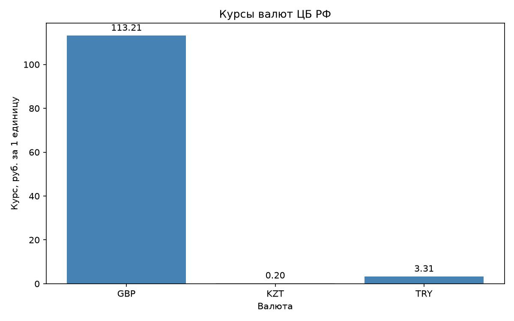

# Курсы валют ЦБ РФ

Учебный проект: ООП-обёртка над функцией получения курсов валют с сайта ЦБ РФ.
## График курсов



*Курсы приведены к рублям за 1 единицу валюты (с учётом номинала).
Источник данных: [cbr.ru](http://www.cbr.ru/scripts/XML_daily.asp).*

## Запуск

```bash
pip install -r requirements.txt
python currencies.py